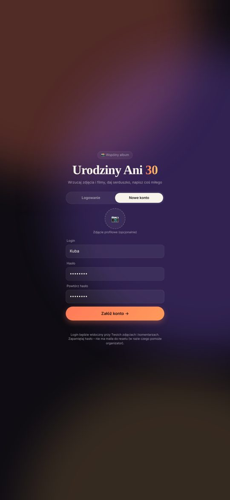
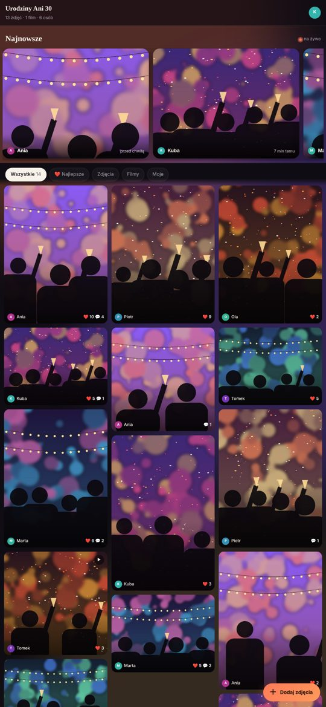
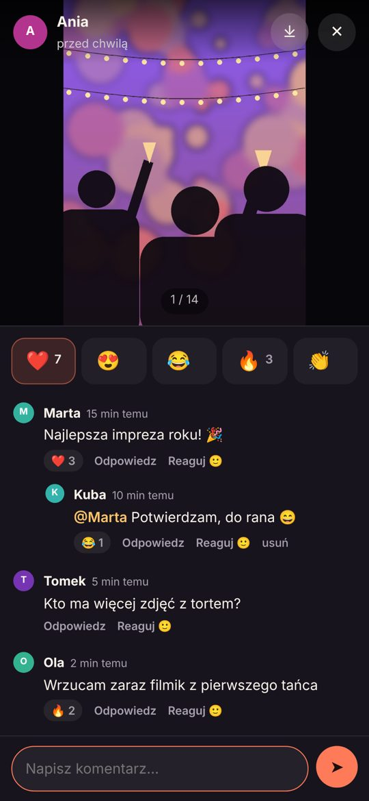

# 📸 Album z imprezy

Wspólny album na zdjęcia i filmy z wesela, urodzin czy osiemnastki. Goście skanują kod QR, zakładają konto (sam login i hasło, bez maila) i wrzucają zdjęcia prosto z telefonu. Pliki trafiają **do folderu na Twoim Google Drive**, a na telewizorze lecą na żywo w pokazie slajdów.

Całość działa na darmowym **Google Apps Script**, bez serwera, abonamentu i reklam. Opcjonalnie możesz podpiąć własną domenę przez Cloudflare Pages.

<p align="center">
  
  
  
  
</p>
<p align="center"></p>

<sub>Zrzuty ekranu pochodzą z wersji demo z przykładowymi grafikami.</sub>

## Co potrafi

- **Wrzucanie zdjęć i filmów** z telefonu: kilka plików naraz, z paskiem postępu. Pliki idą w kawałkach po 8 MB, więc przechodzą też długie filmy, a zerwane połączenie jest wznawiane.
- **Konta gości** z samym loginem i hasłem, bez maila. Do tego zdjęcie profilowe z prostym edytorem (przybliżanie, kadrowanie, obrót).
- **Reakcje** ❤️ 😍 😂 🔥 👏 i **komentarze** z odpowiedziami.
- **Galeria na żywo**: pasek „Najnowsze”, filtry (Najlepsze, Zdjęcia, Filmy, Moje) i podgląd na pełnym ekranie z przesuwaniem palcem.
- **Pokaz slajdów na TV lub rzutnik** (`?view=pokaz`): nowe zdjęcia pojawiają się po kilkudziesięciu sekundach, a w rogu jest kod QR dla kolejnych gości.
- **Kod QR** do wydrukowania na stoły, wbudowany w menu.
- **Administrator** może usuwać zdjęcia i komentarze, blokować konta i resetować hasła.
- **Bezpieczne uprawnienia**: skrypt widzi tylko pliki, które sam utworzył (`drive.file`), a nie cały Twój Dysk.

## Pliki

| Plik | Co to jest |
|---|---|
| `Code.gs` | Backend: konta, wysyłanie na Dysk, reakcje, komentarze, moderacja |
| `Index.html` | Cała aplikacja w przeglądarce (album, wrzucanie, podgląd, pokaz slajdów) |
| `appsscript.json` | Ustawienia projektu: uprawnienia i tryb aplikacji internetowej |
| `cloudflare/index.html` | Opcjonalna strona do osadzenia albumu pod własną domeną |

## Uruchomienie (ok. 15 minut)

### 1. Projekt Apps Script
1. Wejdź na [script.google.com](https://script.google.com) i kliknij **Nowy projekt**. Nazwij go np. „Album impreza”.
2. Wklej zawartość `Code.gs` do pliku `Code.gs` w edytorze.
3. Kliknij **+ → HTML** i nazwij plik dokładnie `Index`, z wielkiej litery i bez `.html`. Wklej do niego `Index.html`.
4. **⚙️ Ustawienia projektu**: zaznacz *Pokaż plik manifestu „appsscript.json”*, a potem wklej jego zawartość z repo.

### 2. Konfiguracja
Na górze `Code.gs` uzupełnij `CONFIG`:

```js
const CONFIG = {
  EVENT_NAME: 'Urodziny Ani 30',     // tytuł albumu i nazwa folderu na Dysku
  ADMIN_LOGIN: 'admin',
  ADMIN_PASSWORD: 'min-8-znakow',    // KONIECZNIE zmień, inaczej admin jest wyłączony
  REGISTRATION_CODE: '',             // opcjonalny kod imprezy, np. 'ania30'
  PUBLIC_URL: '',                    // Twoja domena (krok 5), trafia do kodu QR
  // ...
};
```

> ⚠️ Nie wrzucaj do publicznego repo `Code.gs` z prawdziwym hasłem administratora.

### 3. Pierwsze uruchomienie
1. Wybierz funkcję `test` i kliknij **Uruchom**.
2. Zatwierdź uprawnienia: **Zaawansowane → Przejdź do… → Zezwól**.
3. W dzienniku zobaczysz link do folderu imprezy, który skrypt sam utworzył na Twoim Dysku, i komunikat `Administrator: admin – OK`.

<details>
<summary><b>Google pisze „Ta aplikacja jest zablokowana”?</b></summary>

Niektóre konta blokują skrypty podpięte do domyślnego projektu. Pomaga podpięcie własnego projektu Google Cloud (bezpłatnie, ok. 10 min):

1. [console.cloud.google.com](https://console.cloud.google.com): **Nowy projekt**, potem wyszukaj **Google Drive API** i kliknij **Włącz**.
2. **Google Auth Platform** (ekran zgody OAuth): odbiorcy **Zewnętrzni**, następnie **Odbiorcy → Użytkownicy testowi → dodaj swój Gmail**.
3. Skopiuj **numer projektu** (same cyfry) z panelu.
4. W Apps Script przejdź do **⚙️ → Projekt Google Cloud → Zmień projekt**, wklej numer i ponownie uruchom `test`.

Jeśli to nie pomoże, sprawdź, czy na koncie nie jest włączona **Ochrona zaawansowana** Google.
</details>

### 4. Wdrożenie
1. Kliknij **Wdróż → Nowe wdrożenie → Aplikacja internetowa**.
2. Ustaw *Wykonaj jako: **Ja*** i *Kto ma dostęp: **Każdy***.
3. Skopiuj adres kończący się na `/exec`. To jest Twój album.

Po każdej zmianie kodu wybierz **Wdróż → Zarządzaj wdrożeniami → ✏️ → Wersja: Nowa wersja**. Adres zostaje ten sam.

### 5. Własna domena (opcjonalnie)
1. W `cloudflare/index.html` wklej swój adres `/exec` w miejsce `const APP = '…'`.
2. W Cloudflare przejdź do **Workers & Pages → Utwórz → Pages → Prześlij zasoby** i wgraj ten jeden plik.
3. W projekcie wybierz **Domeny niestandardowe → Dodaj** i wpisz np. `impreza.twojadomena.pl`.
4. Wpisz ten adres w `CONFIG.PUBLIC_URL` i wdróż nową wersję. Kod QR będzie wtedy prowadził na Twoją domenę.

## Linki dla gości

| Adres | Widok |
|---|---|
| `…/exec` lub `impreza.twojadomena.pl` | Album: logowanie, wrzucanie, galeria |
| `…?view=pokaz` | Pokaz slajdów na telewizor |

## Kolejna impreza

Uruchom w edytorze funkcję `nowaImpreza`. Utworzy nowy folder i wyczyści konta, reakcje oraz komentarze. Stare zdjęcia zostają w poprzednim folderze na Dysku.

## Dobrze wiedzieć

- Wszystko zajmuje miejsce na **Twoim** Dysku (darmowe konto ma 15 GB), a filmy szybko je zapełniają.
- Pliki są udostępniane jako „każdy z linkiem”, bo inaczej miniatury by się nie wyświetlały. Linków nie da się zgadnąć, ale do albumu wchodzi się po zalogowaniu.
- Filmy tuż po wrzuceniu przez kilka minut nie mają miniatury, bo Google je jeszcze przetwarza.
- Darmowy Apps Script obsłuży imprezę na kilkadziesiąt do stu kilkudziesięciu osób. To nie jest usługa dla tysięcy użytkowników.

## Licencja

MIT: rób z tym, co chcesz, także komercyjnie. Szczegóły w pliku [LICENSE](LICENSE).
